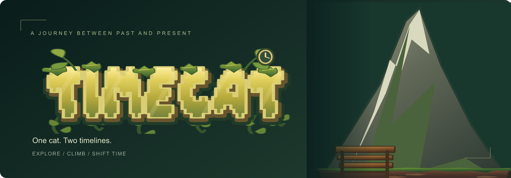

<p align="center">
  
</p>

<p align="center">
  A Unity platform adventure about a cat moving between the past and present.
</p>

<p align="center">
  <strong><a href="https://unlim8ted.com/products/games/TimeCat/">Play the demo</a></strong>
  &nbsp; &middot; &nbsp;
  <a href="#getting-started">Getting started</a>
  &nbsp; &middot; &nbsp;
  <a href="#editing-the-art">Editing the art</a>
</p>

---

## One cat. Two timelines.

Explore forests and laboratories, climb through the environment, and switch between past and present. TimeCat brings platforming, environmental puzzles, and a spider boss encounter together across nine scenes.

| Travel through time | Find a way forward | Face what follows |
| :--- | :--- | :--- |
| Switch between the past and present. | Climb, move objects, and work through doors and obstacles. | Navigate hazards and survive the spider encounter. |

## Getting started

**Unity 2021.3.45f1** &middot; Open `Assets/Scenes/Title.unity`

1. Install **Unity 2021.3.45f1** through Unity Hub.
2. Add this folder as a project and let Unity restore the packages and import the assets.
3. Open the **Title** scene and press **Play**.

The project includes the title screen, opening level, and seven laboratory levels. All nine scenes are listed in Build Settings.

### Build the game

Install the platform module you need through Unity Hub, then open **File &rarr; Build Settings** and select your target platform. Build outputs are generated locally.

For Linux IL2CPP builds, also install Unity's matching Linux toolchain.

## Editing the art

Editable SVGs live in [`ArtSources`](ArtSources). Their rendered textures live in `Assets/Art` and `Assets/Resources`; Unity uses those textures directly.

**With Python 3.12:**

```sh
python -m pip install -r Tools/requirements.txt
python Tools/update_art.py
```

On Windows, use `py -3.12` in place of `python`.

Edit an SVG, run the updater, and return to Unity to see the imported texture. The updater matches each SVG to an existing texture by its relative folder and filename, without a manifest.

Keep filenames, relative folders, and canvas dimensions unchanged so the existing sprite slices and references continue to work. The updater preserves Unity's `.meta` files, including asset GUIDs and import settings.

Python is only needed to update artwork. You can open and play the Unity project without it.

## Inside the project

<details>
<summary><strong>Browse the folder guide</strong></summary>

| Folder | Contents |
| :--- | :--- |
| [`Assets/Scripts`](Assets/Scripts) | Player movement, climbing, timeline switching, enemies, audio, and UI |
| [`Assets/Scenes`](Assets/Scenes) | Title, opening level, and seven laboratory levels |
| [`Assets/Prefabs`](Assets/Prefabs) | Reusable game objects |
| [`Assets/Animations`](Assets/Animations) | Character clips, controllers, and the boss state graph |
| [`Assets/Art`](Assets/Art) | Textures and sprite sheets rendered from SVGs |
| [`Assets/Resources`](Assets/Resources) | Assets loaded at runtime |
| [`Assets/ThirdParty`](Assets/ThirdParty) | Joystick controls and particle-pack dependencies |
| [`Assets/Settings`](Assets/Settings) | Rendering and lighting assets |
| [`ArtSources`](ArtSources) | Editable SVG artwork |
| [`Packages`](Packages) | Unity package dependencies |
| [`ProjectSettings`](ProjectSettings) | Input, physics, rendering, and build configuration |
| [`Tools`](Tools) | Python art updater and its dependencies |

</details>

---

<p align="center">
  <a href="https://unlim8ted.com/products/games/TimeCat/">TimeCat &middot; Unlim8ted Studios</a><br>
  <sub>Copyright and usage terms: <a href="LICENSE.txt">LICENSE.txt</a>. Third-party packages retain their own licenses.</sub>
</p>
